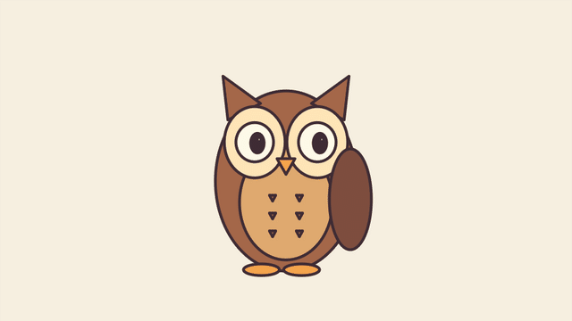
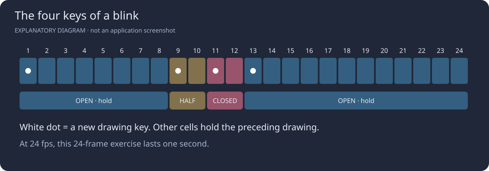
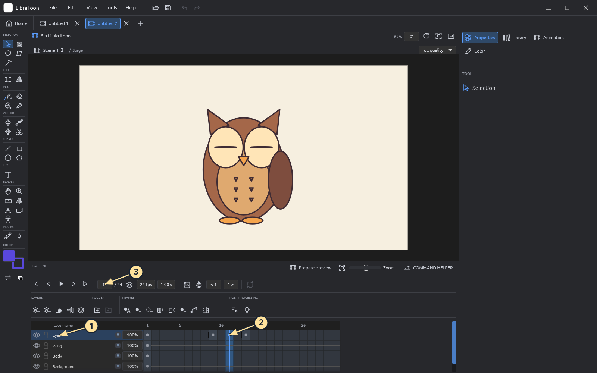

# 2 · Make the Owl Blink

**Result:** the owl blinks once and holds its expression. **Start:** the drawing from lesson 1. Save a copy as `Owl-02-Blink.ltoon`.

*Rendered eye states, slowed down for clarity. If you prefer a still image, compare the [closed pose](../assets/images/blink-10.png) with the [open pose](../assets/images/blink-0.png).*

[Download the finished blink project](../assets/projects/02-blink.ltoon). The Eyes layer contains the four drawing keys used in this lesson.

## Separate the moving feature

1. Keep the body artwork on its original layer. Put the eyes on a separate vector layer using Cut and Paste, checking that they remain aligned.
2. Set a short duration of 24 frames in the timeline.
3. On the eye layer, keep frame 1 as the open-eye key.
4. At frame 9, insert a regular keyframe that keeps the drawing. Flatten the eyes slightly using Selection or edit their nodes.
5. At frame 11, insert another key and draw the closed lids. Use a blank key if you want to replace the eyes completely.
6. At frame 13, insert a key with the open eyes again. Copy the drawing from frame 1 if needed.

*Timing diagram, not a screenshot. The dots mark new keys; the colored spans show the drawings that are held between them.*

*Headless editor capture at frame 11. Look at the Eyes row: the body and wing stay on held drawings while the eye keys change.*

1. **Eyes layer:** select this row before changing an eye drawing.
2. **Closed-eye key:** the playhead is on the third drawing key.
3. **Current frame:** the readout confirms frame 11.

## Check the timing

Scrub frames 1–24. Frames between keys hold the last drawing. Turn on onion skin while editing to compare alignment, then turn it off to judge the actual result. Play the animation.

!!! success "Checkpoint"
    The body stays still. The eyes change only at your keys and return to open. To slow the blink, drag its keys farther apart; to shorten it, move them closer.

!!! tip "If the body changes too"
    Check which layer was active when you inserted the keys. Undo the edit and select the eye layer before trying again.

**Next:** [Build a Forest Shot](03-forest.md).
