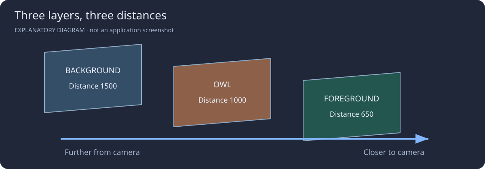
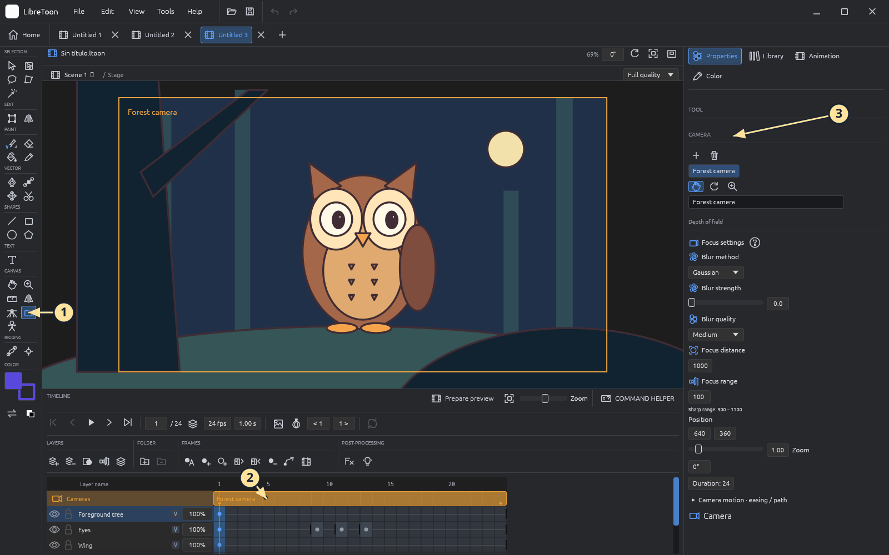

# 3 · Build a Forest Shot

**Result:** a short camera move through a layered forest. **Start:** a static copy of lesson 1, or your blinking owl. Save as `Owl-03-Forest.ltoon`.

*Three rendered camera positions, shown in a back-and-forth preview. The project itself contains a forward camera move; the return is only for comparison.*

[Download the forest project](../assets/projects/03-forest.ltoon). Open it and select the camera or a layer to inspect the settings.

## Make three planes

1. Add a background vector layer behind the owl. Draw a large sky rectangle and a few distant tree silhouettes.
2. Keep the owl on a middle layer or group.
3. Add a foreground layer with one large tree trunk at the side. Leave the owl visible.
4. Give the three planes distinct **Layer Depth** values. Start with small differences and observe the result before exaggerating them.

*Depth diagram, not a screenshot. These are the distances used in the downloadable example; keep the owl near the reference distance while learning.*

## Frame the shot

1. Add a camera from the timeline controls and inspect its Properties.
2. At the first frame, position the camera so the owl is comfortably inside the shot.
3. At a later frame, create a camera key and make a small position or zoom change.
4. Scrub between the camera keys. Adjust the move until the foreground gives a sense of depth without hiding the owl.
5. If desired, adjust camera focus and blur strength to soften a distant plane. Compare with blur disabled.

*Headless editor capture. The camera track is above the drawing layers, and the camera settings appear in Properties. The example leaves depth-of-field blur off so you can study framing first.*

1. **Camera tool:** work on camera framing.
2. **Camera track:** scrub or choose the camera's keys here.
3. **Camera properties:** inspect the selected camera and its settings.

!!! success "Checkpoint"
    The composition changes as you scrub. Camera motion changes the framing; it does not rewrite the owl's vector points. Save the project.

!!! tip "Compare a working example"
    Open **Home → Examples → Woodland · Focus pull** in a separate document to inspect layer depth and camera focus settings.

**Next:** [Light the Night](04-lighting.md).
