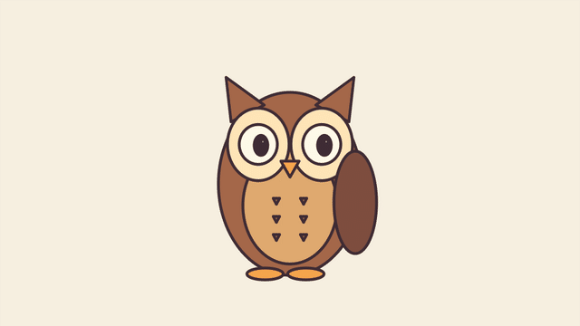
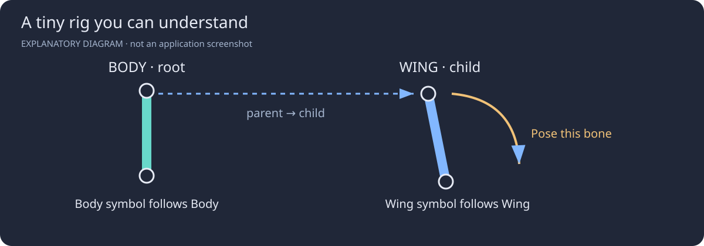
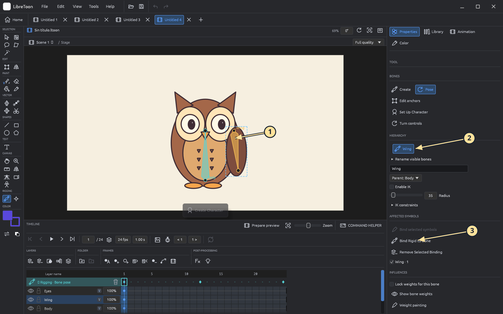

# 5 · Rig a Waving Wing

**Result:** an owl with a wing that follows a bone. **Start:** a clean static copy of lesson 1. Save as `Owl-05-Rig.ltoon`. Leave lighting off while learning the rig.

*Three sampled poses, slowed down for comparison. The downloadable project interpolates between its actual bone keys.*

[Download the wing rig](../assets/projects/05-rig.ltoon). It has a Body root, a Wing child, and one rigid binding per symbol. The eyes are separate artwork in this introductory example.

## Prepare the parts

1. Select the body artwork and convert it to a symbol. Name it `Body` in the conversion dialog.
2. Convert the separate wing to another symbol named `Wing`. Keep the wing's shoulder overlapping the body slightly.
3. Choose **Bones**. Create a short root bone through the torso, then a child bone from the shoulder toward the wing tip.
4. Select the wing and use **Bind selected symbols** with the wing bone selected. Then use **Bind Rigid to Bone** so the wing moves as a solid piece.
5. Bind the body to the torso root if it should follow the rig.

*Binding diagram, not a screenshot. The dashed arrow represents the parent relationship; it is not another bone to draw.*

*Headless editor capture. Select Wing in the bone list to inspect its binding. Pose the child bone to move the wing; rotating the root affects its descendants.*

1. **Wing bone:** the child that drives the wing symbol.
2. **Selected bone:** verify the name and parent before posing it.
3. **Rigid binding:** use a single bone for this simple solid wing.

## Test before animating

Switch to posing and rotate the wing bone a little. Check that the wing follows and the body stays in place. Restore the pose before adding keys. If the wing moves around the wrong point, adjust the bone anchor in setup rather than distorting the artwork to compensate.

## Make a small wave

1. Set an initial bone pose at the first frame.
2. At a later frame, rotate the wing upward and set a pose key.
3. Add a later key returning to the starting pose.
4. Scrub, then play. Expand the **Rigging** track to inspect the controller keys.
5. Save and reopen a separate copy to check that the rig and its keys are retained.

!!! success "Checkpoint"
    The wing follows its own bone and the owl's body remains stable. You can adjust the wave by changing a pose key rather than redrawing every frame.

!!! tip "If the whole owl rotates"
    Confirm that you selected the child wing bone and that the wing is bound to that bone. A selected root or whole character transform affects more than one part.

For turnaround artwork, eyes, pupils, hands and reusable controllers, continue with [Symbols, Clips and Rigging](../rigging.md). Build those systems one at a time after the simple binding works.
